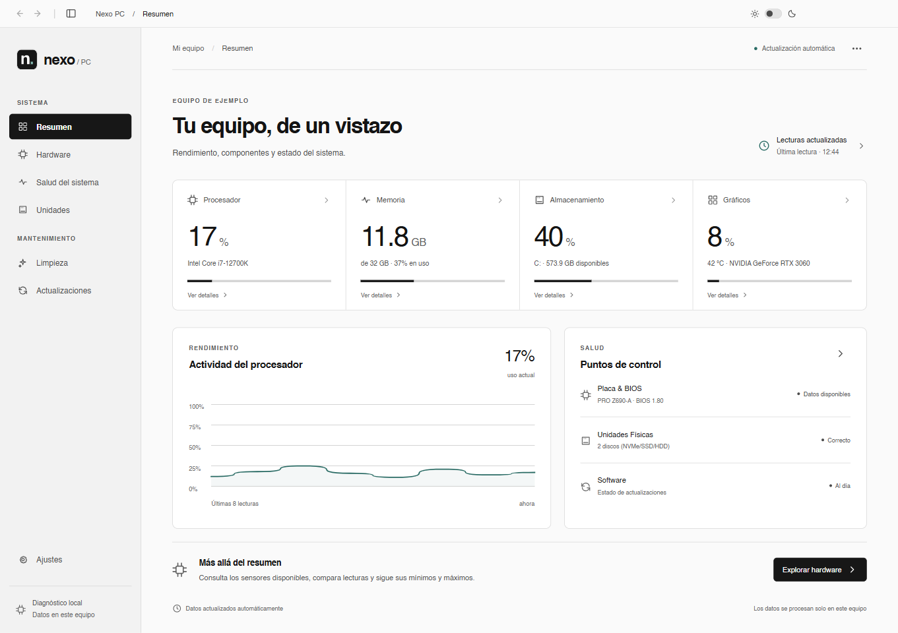
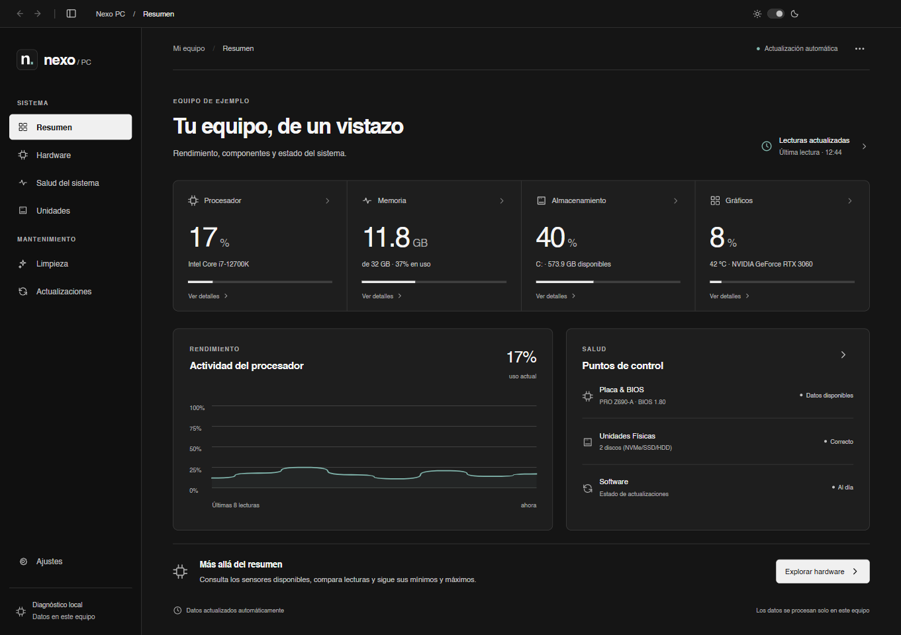
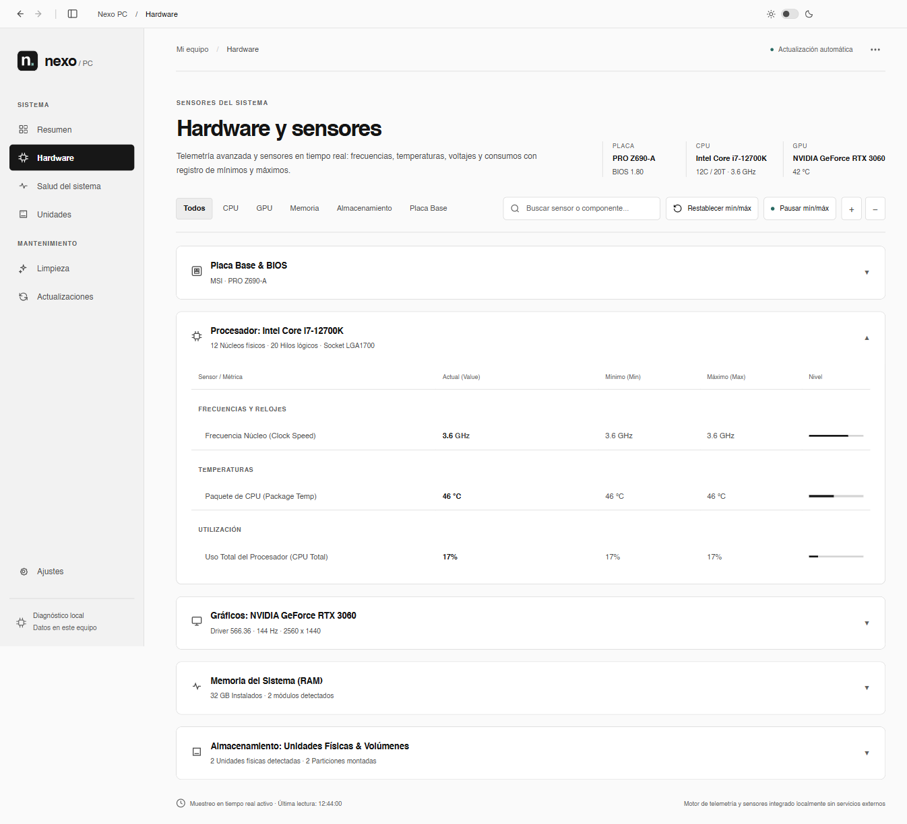
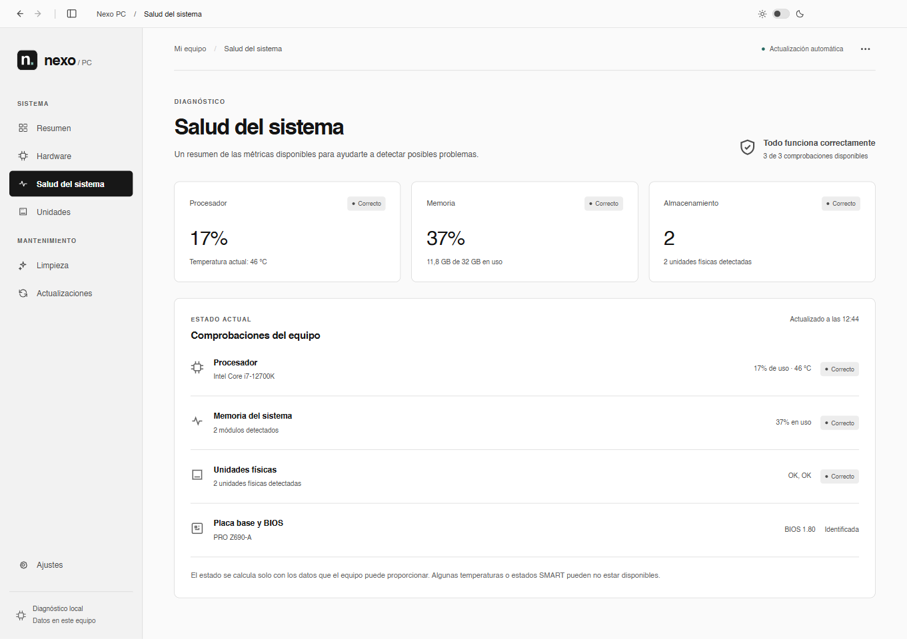
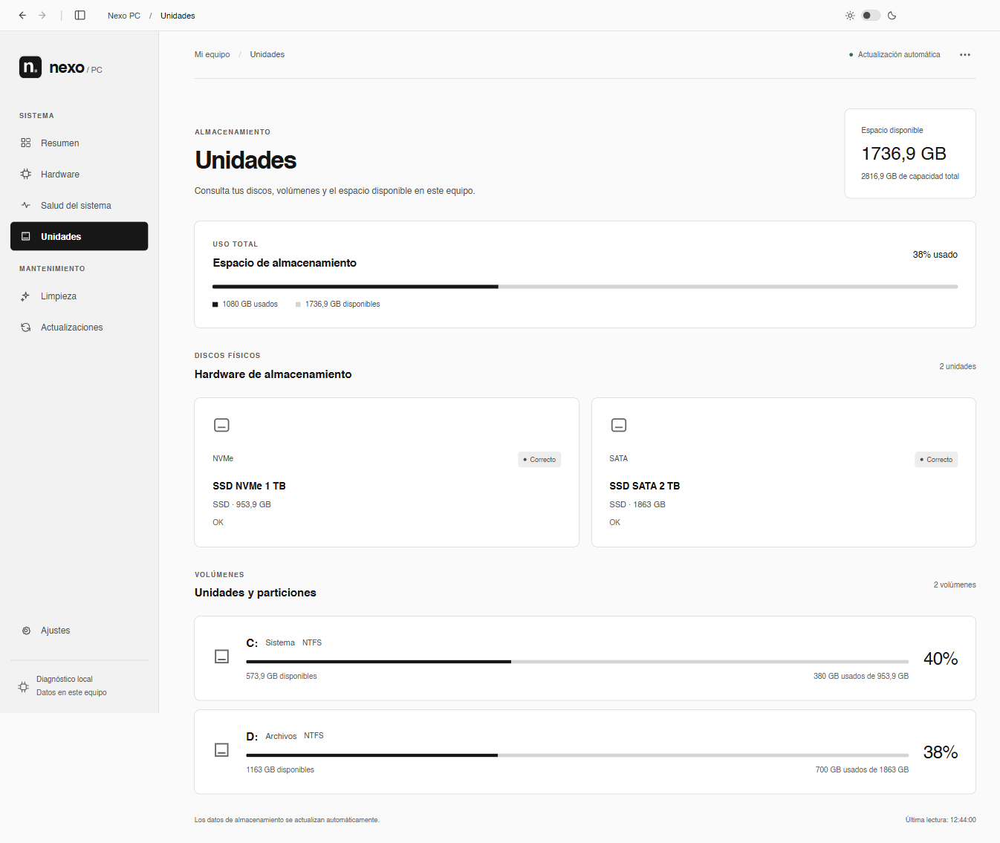
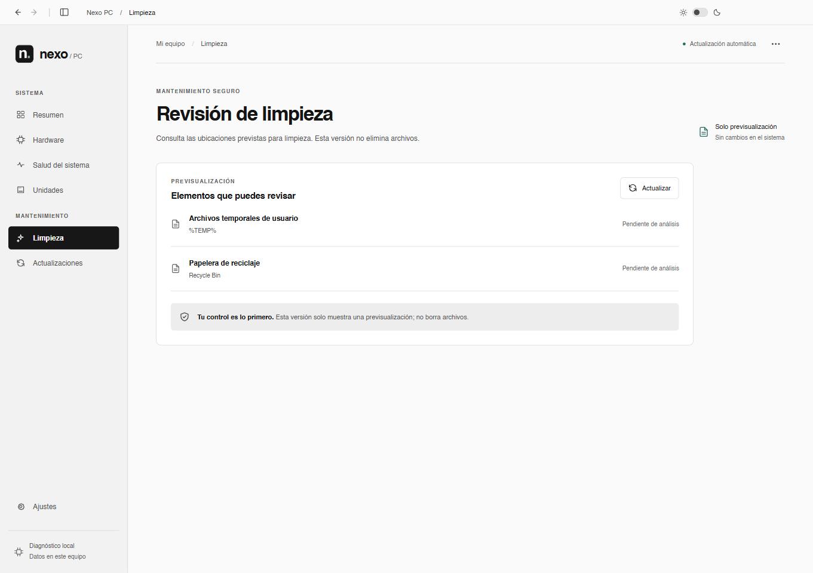
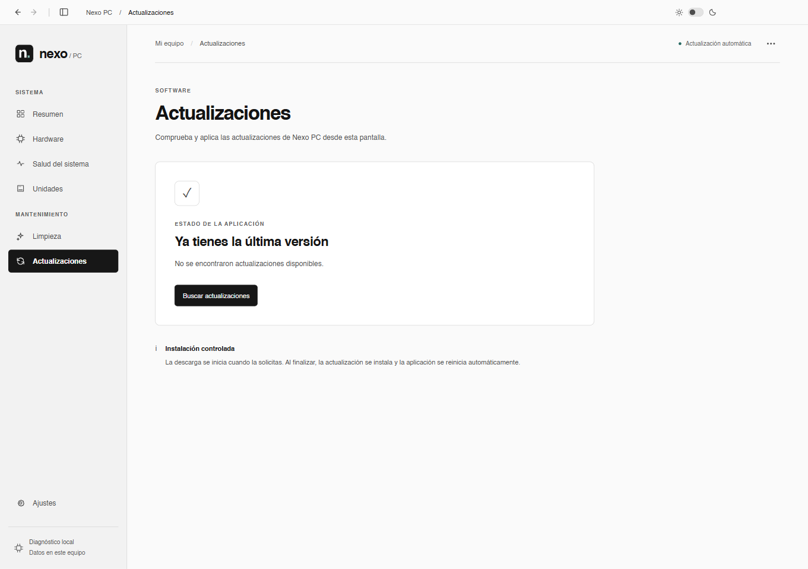
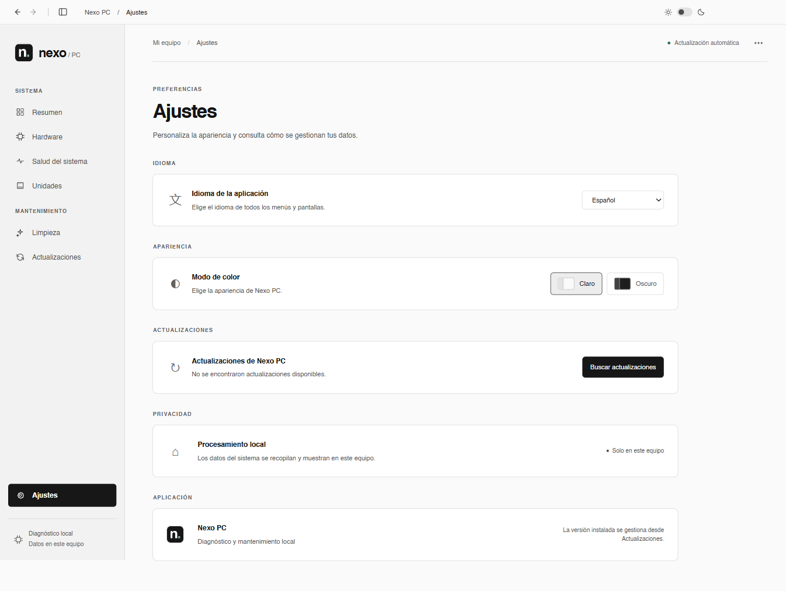

# Nexo PC

Diagnóstico local para Windows. Consulta el rendimiento, los componentes y el almacenamiento de tu equipo desde una interfaz sencilla, con temas claro y oscuro.

**Versión del código: 0.20.0** · Windows x64

[Descargar el instalador de Windows](https://github.com/JaviBarrientos17/nexo-pc-app/releases/latest) · [Publicaciones y versiones](https://github.com/JaviBarrientos17/nexo-pc-app/releases)



## Instalar y empezar

1. Abre la última publicación y descarga el archivo `Nexo-PC-Setup-<version>-x64.exe`.
2. Ejecuta el instalador y elige la carpeta de destino.
3. Abre **Nexo PC** desde el escritorio o el menú Inicio. La primera lectura puede tardar unos segundos.

La aplicación instalada no necesita Node.js ni npm. Requiere Windows 10 1809–22H2 o Windows 11, en un equipo x64.

## Qué puedes hacer

| Sección | Función |
| --- | --- |
| Resumen | Consulta CPU, memoria, almacenamiento y GPU. Cada métrica abre directamente su componente. |
| Hardware | Filtra componentes, busca sensores y consulta valores actuales, mínimos y máximos. Puedes pausar el registro de mín./máx. y restablecerlo. |
| Salud del sistema | Revisa las comprobaciones disponibles de procesador, memoria, discos y placa base. |
| Unidades | Consulta capacidad, espacio disponible y detalles de discos físicos y volúmenes. |
| Limpieza | Previsualiza las ubicaciones previstas para limpieza. Esta versión no elimina archivos. |
| Actualizaciones | Busca y descarga nuevas versiones publicadas en GitHub. |
| Ajustes | Cambia entre español e inglés y entre los temas claro y oscuro. |

El menú de opciones de cada vista permite exportar sus datos como **TXT** o **CSV**.

Los datos de hardware se recopilan localmente mediante CIM/WMI. El muestreo se realiza cada 15 segundos, o cada 30 segundos en equipos con cuatro hilos o menos, y se pausa mientras la ventana está oculta. Las comprobaciones y descargas de actualizaciones acceden a GitHub.

Las lecturas dependen de lo que Windows y los controladores puedan proporcionar. Una temperatura o un estado SMART no disponible se muestra como tal.

## Capturas

Capturas de la aplicación 0.20.0 con **datos de ejemplo**. Los valores y sensores disponibles cambian según el equipo.

<details>
<summary>Resumen en modo oscuro</summary>



</details>

<details>
<summary>Hardware y sensores</summary>



</details>

<details>
<summary>Salud del sistema</summary>



</details>

<details>
<summary>Unidades y almacenamiento</summary>



</details>

<details>
<summary>Previsualización de limpieza</summary>



</details>

<details>
<summary>Actualizaciones</summary>



</details>

<details>
<summary>Ajustes</summary>



</details>

## Helvetica en Windows

La interfaz utiliza Helvetica si está instalada, con Arial como alternativa. Para instalar el pack local `helvetica-255.zip` para tu usuario, ejecuta desde la carpeta del repositorio:

```powershell
powershell -NoProfile -ExecutionPolicy Bypass -File .\scripts\Install-Helvetica.ps1
```

El script busca el ZIP en `Downloads` y no necesita permisos de administrador. También puedes indicar otra ubicación o comprobar primero qué cambios haría:

```powershell
powershell -NoProfile -ExecutionPolicy Bypass -File .\scripts\Install-Helvetica.ps1 -ArchivePath "C:\ruta\helvetica-255.zip" -WhatIf
```

Para instalar, repite el comando sin `-WhatIf` y vuelve a abrir Nexo PC. Se reconocen las siete variantes del pack; si ya existe una versión diferente de alguna fuente, el script se detiene antes de sustituir archivos.

Cada usuario debe disponer de su copia con licencia. El ZIP y los archivos de Helvetica no se incluyen en este repositorio ni en el instalador de la aplicación.

## Desarrollo

Necesitas Git, Windows y Node.js 22 con npm, la versión usada en GitHub Actions.

```powershell
git clone https://github.com/JaviBarrientos17/nexo-pc-app.git
cd nexo-pc-app
npm ci
npm start
```

`npm start` compila la interfaz y el proceso de Electron antes de abrir la aplicación.

### Comprobar y compilar

```powershell
npm run lint
npm test
npm run build
```

### Crear el instalador

```powershell
npm run package:win
```

El resultado se guarda en `release/`: instalador de Windows x64, archivo `.blockmap` y manifiesto `latest.yml`. Este comando no publica archivos en GitHub.

### Publicar una versión

La versión se declara en `package.json` y `package-lock.json`. Antes de publicar una nueva versión:

```powershell
npm version <version> --no-git-tag-version
```

Confirma ambos archivos junto con los cambios. Al integrar la rama en `main`, el [workflow de publicación](.github/workflows/release.yml) comprueba el código, compila y publica el instalador, su `.blockmap` y `latest.yml` bajo la etiqueta `v<version>`. Conserva la versión declarada; cada publicación necesita una etiqueta nueva.

El workflow usa `GITHUB_TOKEN`. La firma del instalador es opcional y se configura con `WIN_CSC_LINK` y `WIN_CSC_KEY_PASSWORD`. El repositorio debe ser público para que la aplicación pueda descargar las actualizaciones sin autenticación.

## Documentación

[Alcance y decisiones del producto](docs/PLAN_INICIAL.md)
